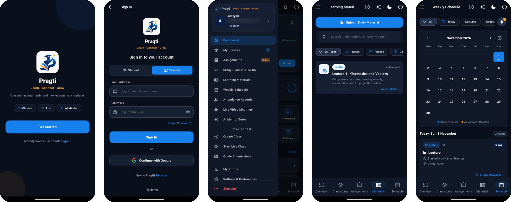
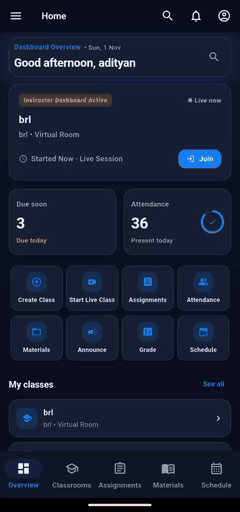
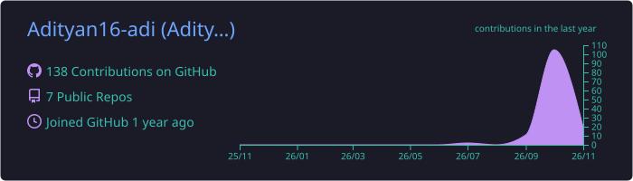
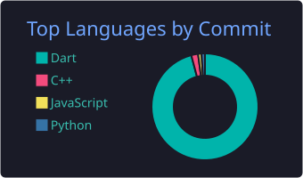
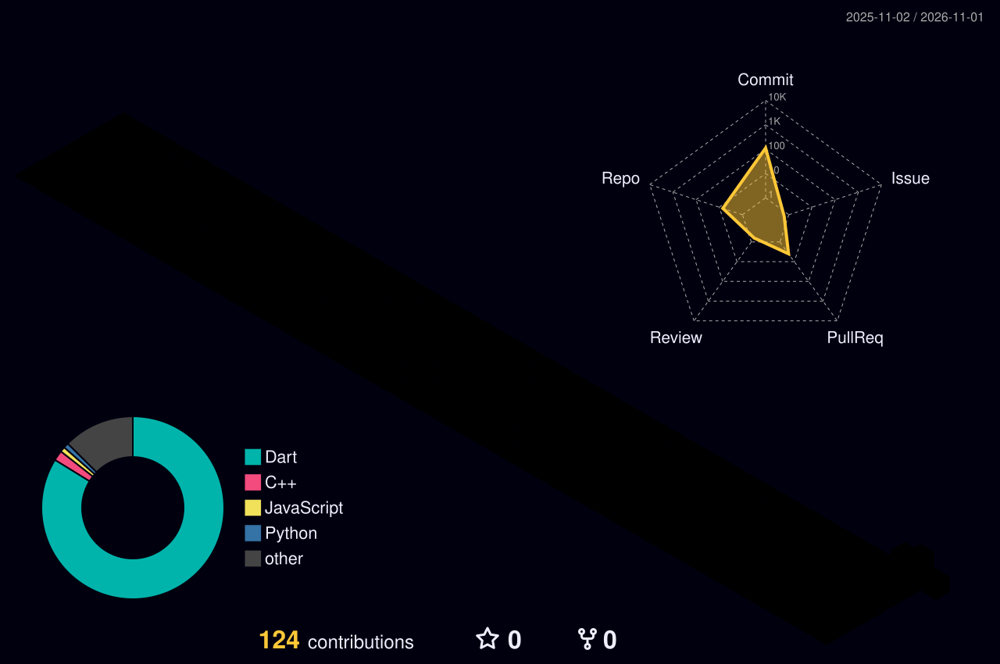

---

## About me

Computer Science student building Flutter apps with real backends: authentication, image uploads, state management, third-party APIs, and live video classes. I also work on the AI and backend side of projects so I can ship complete products, from the interface to the server.

- **Focus:** Mobile app development with Flutter and Dart
- **Mobile stack:** Firebase Auth, Riverpod, REST APIs, Cloudinary
- **Worked with (team projects):** Node.js, Express, MongoDB, FastAPI, LiveKit
- **Currently building:** Pragti, a unified learning and virtual classroom app (see below)

---

## Open to

- Flutter and mobile development internships
- Freelance app projects
- Collaborating on AI and full-stack projects

If any of these sound like a fit, reach me at [adityanpushkar@gmail.com](mailto:adityanpushkar@gmail.com) or on [LinkedIn](https://www.linkedin.com/in/adityan-pushkar-6bb316344/).

---

## Tech

**Mobile**

**Backend and AI**

**Tools**

---

## Skills

| Level | What |
|---|---|
| **Comfortable** | Flutter, Dart, Firebase Auth, Riverpod, REST APIs, Git and GitHub |
| **Working knowledge** (team projects) | Node.js, Express, MongoDB, Python, FastAPI, LiveKit |
| **Learning** | AI agents, full-stack architecture |

---

## Featured projects

<table>
<tr>
<td width="170" align="center">

</td>
<td>
<h3><a href="https://github.com/Adityan16-adi/brl-final_task-">Pragti: Learning &amp; Virtual Classroom</a></h3>
<b>Flutter · Dart · Firebase Auth · Node.js · Express · MongoDB · LiveKit · FastAPI</b>

A team project that combines Google Classroom-style learning (notes, assignments) with Meet-style live classes in one app. It has student and teacher roles, Firebase sign-in, live meetings through LiveKit, and an AI mentor backed by a FastAPI service.

<b>My role:</b> I built and own the Flutter mobile app, including the UI, auth flow, and API integration.

<a href="https://github.com/Adityan16-adi/brl-final_task-">View repository →</a>
</td>
</tr>
</table>

Pragti: welcome, sign in, navigation drawer, learning materials, and weekly schedule

  

Quick walkthrough: dashboard, learning materials, and the AI mentor

---

### [InsightAgent](https://github.com/Adityan16-adi/InsightAgent)

**AI Agents · Python · Vite**

An autonomous market research agent that investigates investment opportunities and organizes its findings into structured venture research.

**Solo project:** I designed and built it end to end.

[View repository →](https://github.com/Adityan16-adi/InsightAgent)

---

### [Campus Marketplace](https://github.com/Adityan16-adi/campus-marketplace)

**Flutter · Dart · Firebase · Riverpod · Cloudinary**

A mobile app that makes it easier for students to buy and sell within their campus community. Firebase handles authentication, Riverpod manages state, and Cloudinary handles image uploads.

[View repository →](https://github.com/Adityan16-adi/campus-marketplace)

---

### [PRAVEG](https://github.com/ARYAN0-work/PRAVEG)

**AI · Predictive Analytics · GIS**

A team project exploring how predictive analytics and geospatial visualization can help identify infrastructure and land-acquisition delays.

**My role:** Built the GIS mapping module and integrated it into the main codebase.

[View repository →](https://github.com/ARYAN0-work/PRAVEG)

---

### [Flutter Pokédex](https://github.com/Adityan16-adi/pokedex-flutter-app)

**Flutter · Dart · REST APIs**

A Pokémon explorer built on PokéAPI with a glassmorphism UI, a landing screen, name search, type filtering, and infinite scroll that loads every Pokémon with no fixed limit.

  
  
  
  

[View repository →](https://github.com/Adityan16-adi/pokedex-flutter-app)

---

## GitHub stats

---

## Activity

---

## Currently building

- **Pragti:** polishing the Flutter app (live meetings, assignments, AI mentor, UI)
- **Next up:** more complete, production-ready mobile apps with solid backends

*Always learning, building, and getting better.*

