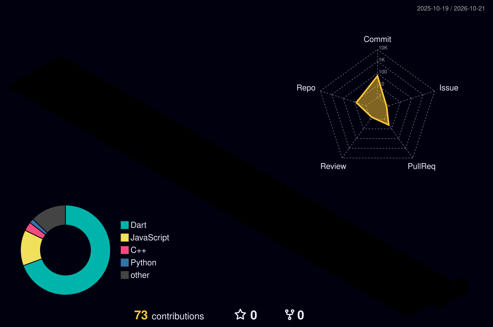

 

 

  

  

---

## About me

I'm a Computer Science student interested in building mobile applications and understanding how good software works behind the scenes.

I mainly work with Flutter and Dart, and I enjoy turning ideas into apps that are useful, intuitive, and enjoyable to use. I'm also exploring AI development and full-stack engineering so I can build more complete products, from the interface to the backend.

I'm still learning, experimenting with new technologies, and improving through the projects I build along the way.

- **Currently focused on:** Mobile app development with Flutter
- **Working with:** Dart, Firebase, Riverpod, and REST APIs
- **Also exploring:** AI-powered applications and full-stack development
- **Tools I use:** Git, GitHub, VS Code, and Postman

---

## Technologies

**Mobile development**

**AI and backend**

**Web and tools**

---

## Selected projects

### Campus Marketplace

A Flutter app focused on making it easier for students to buy and sell within their campus community. The project uses Firebase for authentication, Riverpod for state management, and Cloudinary for image uploads.

*Repository link to be added.*

### Flutter Pokédex

A mobile app built with Flutter that uses PokéAPI to explore Pokémon, search entries, and filter by type. It has been a useful project for learning API integration and mobile UI development.

*Repository link to be added.*

### PRAVEG

A project exploring how predictive analytics and geospatial visualization can help identify infrastructure and land-acquisition delays. It brings together machine learning, GIS, and web technologies.

*Repository link to be added.*

### InsightAgent

An AI-assisted research project exploring ways to investigate investment opportunities and organize findings into structured venture research.

[View repository](https://github.com/Adityan16-adi/InsightAgent)

---

## GitHub statistics

  

---

## Contributions

<picture>
  <source media="(prefers-color-scheme: dark)" srcset="https://raw.githubusercontent.com/Adityan16-adi/Adityan16-adi/output/github-snake-dark.svg"/>
  <source media="(prefers-color-scheme: light)" srcset="https://raw.githubusercontent.com/Adityan16-adi/Adityan16-adi/output/github-snake.svg"/>
  
</picture>

---

## What I'm working towards

- Building better mobile experiences with Flutter
- Improving my understanding of app architecture and backend systems
- Exploring practical uses of AI in applications
- Shipping more complete, reliable projects
- Learning from other developers and contributing to open source

*Always learning, building, and getting better.*

